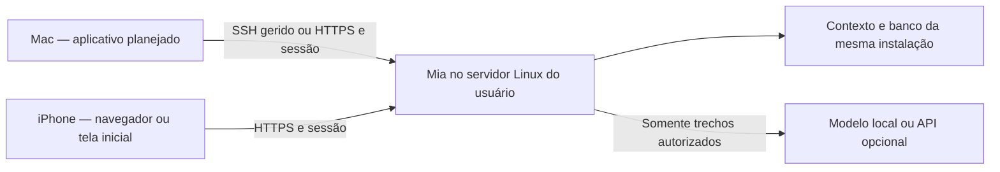

# Mia — migração de contexto e primeiro valor

13/10/2026 · Contrato do ciclo após avaliação 2/10. A 0.2.0a12 implementa a jornada por fontes, jobs retomáveis/revisão por grupos, recuperação por trechos, foco, conversas e serviço de usuário. Mantém identidade, proveniência, aprovação e orçamento. Não atualiza automaticamente a instalação pessoal. A próxima distribuição segue [MAC-DEMO.md](MAC-DEMO.md): aplicativo Mac independente, por convite, com escolha/preparação de destino no onboarding e atualizações dentro do app. O percurso administrativo/navegador anterior não é o caminho principal da demonstração. O app ainda não foi implementado; evidência do núcleo em [EXPERIENCE-VALIDATION.md](EXPERIENCE-VALIDATION.md).

| Entrega | Estado técnico na a12 | Aceite ainda aberto |
| --- | --- | --- |
| E1 | Jornada e taxonomia integradas | Compreensão e primeiro valor com participantes |
| E2 | Serviço de usuário, migração manual e fundação de launcher/empacotador Mac | Ativação/boot real, assinatura/notarização e Mac limpo sem ajuda |
| E3 | Importação retomável, grupos, formatos/proveniência e quotas | Vault real representativo e exports autorizados de participantes |
| E4 | Índice textual, conversas, foco opt-in, trechos em Hoje sem tarefas | Qualidade da retomada real; síntese semântica não é automática |
| E5 | Reimportação idempotente mantém proveniência; versões ficam separadas | Deltas/remoções revisáveis e Drive recorrente |
| E6 | Roteiro e ferramentas técnicas | 2–3 participantes e decisão de release |

## Decisões e evidência

O proprietário avaliou a experiência do zero em **2/10**. Relatou um vault ZIP recusado ao exceder 300 e dificuldade para entender instalação/configuração e manter o serviço no Mac. Isso é uma avaliação de uso real, não um benchmark nem um piloto com participantes externos. O arquivo não foi recebido; tamanho, contagem de notas e formatos internos permanecem desconhecidos.

Escolhas explícitas para o próximo piloto:

- **Resultado inicial:** retomar o trabalho, reconhecendo projetos, últimas decisões e pendências com fontes.
- **Referência do teste do proprietário:** servidor Linux sempre disponível, acessado pelo Mac e iPhone. Novos participantes escolhem instalação local ou servidor; a escolha do proprietário não se torna requisito para eles. A distribuição da demo começa no app Mac, com destino escolhido/preparado dentro dele; iPhone tem configuração/aceite adicional.
- **Objetivo de produto:** contexto próprio portátil e continuidade de trabalho, com custos visíveis. Substituição de assinaturas e economia permanecem hipóteses a medir, não promessas.

A 0.2.0a11 oferece base técnica, mas ainda não oferece migração representativa ou instalação para leigos. Os 141 testes comprovam comportamentos específicos; não contradizem a avaliação de experiência.

| Fricção confirmada no código | Consequência | Mudança proposta |
| --- | --- | --- |
| ZIP limitado a 300 entradas antes de filtrar pastas/metadados/mídia | Um vault pode ser recusado antes de contar notas úteis | Inventário e quotas distintas para arquivo, recursos e conteúdo elegível |
| Upload de 8 MiB, expansão de 20 MiB, parsing síncrono em memória/base64 | Migração grande não progride nem retoma | Transferência limitada por recursos, jobs duráveis e retomada |
| Área obrigatória antes de importar; seleção individual | Pessoa organiza manualmente antes de conhecer a Mia | Importar por origem/pasta/conversa, com revisão agrupada |
| Organização/personalização usa seis fontes e trechos iniciais | Não organiza nem compreende um vault inteiro | Recuperação por trechos e síntese progressiva de grupos, quando autorizada |
| Recuperação lexical de três trechos de 1.200 caracteres, dentro de uma área | Arquivo armazenado pode não produzir uma resposta útil | Melhorar índice, recorte, diversidade e escopo autorizado, com avaliação separada |
| Hoje depende de tarefas cadastradas e objetivo | Biblioteca cheia pode terminar em tela vazia | Retomada baseada em fontes e foco confirmado, mesmo sem tarefas |
| Terminal/SSH/pip usados para instalar e recuperar | Uso cotidiano depende de intervenção técnica | Serviço persistente e instalação/acesso guiados, com diagnósticos claros |

Referências de implementação: `mia/knowledge.py`, `mia/static/assets/app.js`, `mia/organization.py`, `mia/operations.py`. Não basta aumentar o número 300 ou adicionar um resumo por IA.

## Mensagem e modelo mental

Proposta de mensagem: **“Seu contexto de trabalho, reunido na Mia. Retome projetos, encontre decisões e avance com fontes.”** Complemento: **“Você escolhe onde seus dados ficam e qual IA usar.”**

Explicar antes de importar:

1. GitHub distribui o código. Não guarda automaticamente o contexto do usuário nem é uma conta da Mia.
2. Uma instalação Mia guarda o contexto e executa o serviço. O app Mac planejado prepara e acessa essa instalação; o navegador continua como forma alternativa de acesso quando configurado.
3. Cada participante escolhe onde instalar. No cenário remoto, arquivos enviados pelo Mac/iPhone são copiados para o servidor escolhido; no local, ficam na máquina escolhida. Isso deve ser informado antes da transferência.
4. Importar/indexar não envia conteúdo a modelos. Consultar/analisar com IA pode enviar trechos autorizados ao destino escolhido, com consentimento e uso visíveis.
5. API externa pode cobrar por uso; modelo local depende de hardware e energia. Não prometer eliminar gastos ou substituir todos os recursos de Claude/ChatGPT.

Código, documentação e assets próprios usam Apache-2.0; terceiros conservam suas licenças. Dados pessoais não são abrangidos pela licença do software. Mac/Ubuntu têm evidência técnica; suporte universal a sistemas operacionais não foi validado. Windows só será anunciado após distribuição e testes próprios. Próximos aceites por instalação em [ROADMAP.md](ROADMAP.md).

## Uma experiência, três formas de entrar

| Escolha | Dados e execução | Disponibilidade | Papel no plano |
| --- | --- | --- | --- |
| No meu servidor | Uma instalação Linux própria, com serviço/backup e conexão gerida pelo app; HTTPS para outros clientes | Enquanto servidor e rede funcionarem; app reconecta sem Terminal | Assistente planejado; opcional para participantes |
| Neste computador | Serviço local no Mac, com inicialização automática e janela do app | Depende de Mac ligado/acordado; outro dispositivo requer rede preparada | Sugestão inicial, mesmo produto/backend; artefato pendente |
| Conectar à minha Mia | App aponta para instalação existente validada | Depende da instalação e rede | Sem criar outra biblioteca; iPhone exige HTTPS próprio |

Mac e iPhone vendo o mesmo servidor têm acesso ao mesmo contexto. Isso não é sincronização entre dois bancos nem uso offline. Não copiar SQLite vivo via iCloud/Drive.

**Primeiro:** aplicativo Mac com janela própria, runtime incluído e dois caminhos reais de instalação no onboarding. Reutilizar a interface web dentro do app; não enviar o participante a Terminal/TextEdit/navegador como percurso principal. No servidor, o túnel SSH gerido pelo app permite acesso Mac sem domínio público; testar serviço, reconexão e boot. HTTPS de outros clientes exige rede/rota escolhidas e aceite próprio. No Mac, testar login e suspensão/retomada. Instalação, backup e atualização ficam na interface; nenhum assistente declara destino preparado ao salvar uma preferência. Arquitetura e ordem em [MAC-DEMO.md](MAC-DEMO.md) e [ROADMAP.md](ROADMAP.md).

Fechar navegador ou janela do launcher não encerra o serviço. **Parar Mia** é uma ação explícita, com estado visível e aviso de que outros dispositivos perderão acesso. Sono/desligamento do Mac continua reduzindo disponibilidade; abertura automática não remove essa limitação física.

**Entrada local:** app Mac instala runtime, mostra estado e usa janela própria, ou configura/conecta a instalação remota. SwiftUI/AppKit + WKWebView reutiliza o produto existente, sem reescrever todo o frontend. Não exigir Git/Python/pip. Distribuição confiável, assinatura/notarização e atualização integrada são requisitos da demonstração. O gerenciador atual/templates são base, não esse app pronto. Outros sistemas exigem distribuição/validação próprias.

Credenciais de assinatura/notarização e infraestrutura de build são pré-requisitos externos do artefato Mac confiável. Se faltarem, continuar implementação e testes independentes, mas registrar distribuição local pendente. Não substituir o aceite em Mac limpo por instruções para ignorar a proteção do sistema.

**iPhone:** começar pelo navegador/tela inicial, com seleção de arquivos, reconexão e indisponibilidade compreensível. App nativo só quando houver necessidade comprovada de recursos como compartilhar arquivos/notificações. Serviço permanente local no iPhone e sincronização offline ficam fora deste piloto. Não anunciar PWA, launcher ou apps como já entregues.

O contrato da demo dispensa Terminal na instalação suportada e no uso diário. Operar servidor próprio exige endereço, credenciais/permissões e responsabilidade operacional, explicados no assistente. Se depender do fundador ou de comandos no percurso oferecido, o aceite independente falhou. Hospedagem opcional futura não vira infraestrutura obrigatória nem requisito para importar.

O recrutamento pergunta a preferência de instalação antes de orientar. Registrar resultados por modalidade; sucesso no servidor não fecha aceite local e vice-versa. Um participante local sem necessidade de iPhone/remoto não deve preparar domínio, VPN ou servidor. O acesso do iPhone a uma Mia no Mac tem uma exigência de rede/disponibilidade adicional, que deve ser escolhida e explicada, não escondida no onboarding.

## Jornada: da origem até retomar o trabalho

**Chegar → trazer contexto → conferir cobertura → começar a usar → confirmar o que é atual → Hoje.**

1. **Minha Mia:** dentro do app Mac, escolher Neste Mac, No meu servidor ou Conectar à minha Mia. Preparar/conferir o destino real e mostrar onde os dados ficam; criar acesso privado ou entrar. Nome de área, projeto, API e preços não bloqueiam a entrada. O convite libera a distribuição oficial, não o contexto do fundador.
2. **De onde vem seu trabalho?** Escolher várias origens: Obsidian/pasta Markdown, arquivos avulsos, exportação ChatGPT, exportação Claude, arquivos do Drive/outros serviços. Cada origem informa o que aceita e o que ainda não suporta. Sem pedir login da plataforma apenas para importar um export.
3. **Conferir o material:** inventário na instalação escolhida. Mostrar árvore/grupos, tipos, datas disponíveis, volume, conversas/notas reconhecidas, ignorados, conflitos e erros. Seleção por pasta, grupo ou intervalo, com exceções e prévia buscável. Nenhum checkbox obrigatório por nota. Não pedir ao usuário que divida um vault para vencer um limite do produto.
4. **Autorizar a biblioteca:** a pessoa confirma o conjunto que a Mia pode importar e consultar. Guardar proveniência; não alterar originais nem executar plugins, macros, links ou instruções em arquivos. Envio ao modelo continua uma autorização distinta.
5. **Começar progressivamente:** indexar em segundo plano com estado durável, cancelar/retomar e relatório reconciliável. Primeiros grupos autorizados e indexados tornam-se úteis enquanto os demais avançam. Mostrar cobertura parcial e pendências; sucesso parcial nunca aparece como migração completa.
6. **O que continua em andamento?** A partir do material escolhido, apresentar candidatos a projetos, decisões e assuntos; perguntar qual foco é atual. Conteúdo antigo, respostas de assistente e mtime de arquivo não estabelecem prioridades atuais. Confirmar foco não cria tarefas ou altera projetos por inferência.
7. **Primeiro resultado:** retomar um projeto reconhecível com fontes abertas, decisão anterior e questão ainda pendente. Sem IA, oferecer busca e acesso às fontes. Com IA, explicar envio/limite antes de sintetizar; propostas continuam editáveis e exigem aprovação.

Uma tela não deve exigir o vault inteiro indexado para ser útil, nem exigir uma chave para importar. Não gerar resumos de todas as notas por padrão. Priorizar estrutura, busca e recortes; IA opcional analisa o foco escolhido dentro do orçamento autorizado. Se não houver evidência suficiente, pedir orientação e manter as lacunas visíveis.

## Hoje precisa permitir continuar

Na primeira entrada, a ação principal é **“O que vamos retomar?”** e o foco escolhido. A pessoa reconhece seu trabalho em vez de encontrar somente contadores de tarefas.

- **Em andamento:** projetos/assuntos confirmados, com origem e opção de corrigir/arquivar.
- **Últimas decisões encontradas:** material relacionado ao foco, com data disponível, autoria e link para fonte. “Última encontrada” não significa decisão vigente ou cobertura completa.
- **Pendências para revisar:** questões extraídas/sugeridas, claramente diferenciadas das tarefas já aprovadas. Sem inventar prazos, urgência ou obrigações a partir do histórico.
- **Continuar uma conversa ou perguntar:** primeiro pedido com contexto recuperado e referências; threads persistentes e foco explícito estão implementados na a12.
- **Minha migração:** cobertura, origens, falhas/ignorados e novos grupos disponíveis, sem ocupar a tela principal depois de concluída.

Hoje continua útil com zero tarefas: foco, fontes recentes/relevantes e um caminho de retomada. Sem dados, pede uma origem ou uma pergunta concreta, sem inventar uma rotina pessoal. Datas respeitam fuso e distinguem data da fonte, importação e revisão humana.

Sem modelo, oferecer pastas, títulos, busca e fontes relacionadas; a pessoa escolhe o foco e marca decisões atuais. Extração semântica de projetos/pendências e síntese exigem análise autorizada ou aparecem como hipóteses heurísticas identificadas. Não prometer entendimento automático completo no modo sem IA.

## Taxonomia proposta

| Navegação | Pergunta que resolve | Conteúdo |
| --- | --- | --- |
| Hoje | O que retomar e fazer agora? | Foco, decisões, pendências revisáveis, tarefas aprovadas e primeira ação |
| Conversas | Como pensar e avançar com a Mia? | Threads, fontes usadas, propostas, retomada e custo |
| Biblioteca | Que contexto a Mia conhece e pode usar? | Origens/importações, documentos/conversas originais, organização e perfil confirmado |
| Ajustes | Onde roda e quanto/como pode usar? | Instalação/acesso, IA, limites, permissões, backup e atualização |

Busca é transversal. Em Biblioteca, separar **Fontes** (materiais originais), **Projetos e áreas** (organização de trabalho) e **Sobre mim** (declarações confirmadas). Pastas importadas não são automaticamente áreas de autorização ou projetos. Não reutilizar “Meu contexto” para três conceitos diferentes.

Trocar a linguagem de implementação: “Inteligência” → Conversas; “Sistema” → Ajustes; “Execuções” → Histórico do pedido quando necessário; estados técnicos → progresso/ação compreensível. Isto é uma mudança de arquitetura de informação e comportamento, não apenas renomear botões antes de existir conversa contínua.

A autorização no servidor continua explícita por origem/conjunto/identidade; ampliar a navegação não autoriza conteúdo excluído, em revisão ou pausado. Consultas entre pastas/projetos recuperam apenas fontes aprovadas para aquele pedido. Perfil pessoal continua opt-in, visível e revogável.

## Contrato de migração

Separar **originais**, **índice por trechos**, **conteúdo enviado ao modelo** e **memória/tarefa confirmada**. Armazenar algo não confirma sua veracidade, autoria pessoal ou atualidade.

| Origem | Primeira entrega | Cuidados e evolução |
| --- | --- | --- |
| Obsidian/Markdown | ZIP/pasta com revisão de grupos, caminhos e links entre notas; texto longo recortado | `.obsidian`, `.git`, caches e mídia fora da indexação textual, com relatório; plugins não executados. Observação contínua só de pasta explicitamente escolhida, depois |
| ChatGPT/Claude | Adaptadores versionados para exports suportados; conversas escolhidas e mensagens estruturadas | Preservar papel, datas, IDs/ramo e origem disponíveis; informar anexos/ramificações/formato não lidos. Fala antiga de IA não vira fato do usuário. Amostras reais só com autorização |
| Arquivos/pastas | Lote pelo seletor compatível ou ZIP, com progresso | Pasta do cliente não é caminho do servidor; limites do navegador/iOS exigem alternativa clara |
| Drive/outros serviços | Arquivos baixados/exportados pelo usuário entram no mesmo fluxo | `.gdoc` não contém o documento. Conector recorrente depois, com seleção real de pastas, leitura, exportação de documentos nativos, revogação e deltas; autenticação própria opcional |

Nenhum conector escreve na origem neste piloto. Mudanças posteriores produzem versões/conflictos e revisão de remoções; reimportação usa IDs estáveis disponíveis, hashes e proveniência, não posição no export. “Migrar todo o contexto” é meta de cobertura honesta, não garantia de suportar todo recurso/anexo de qualquer plataforma.

Jobs propostos: recebido, inventariando, aguardando revisão, autorizado, indexando, utilizável parcialmente, concluído/parcial/cancelado/erro. Progresso, seleção e efeito persistem após reinício; confirmações repetidas não duplicam fontes/ações. Um cancelamento mantém originais intactos e informa exatamente o que já entrou. Desfazer lote não apaga fontes independentes compartilhadas nem reescreve histórico de respostas anteriores.

Contagens têm dois níveis: **entradas** (diretórios, metadados/ocultos, formatos ignorados, arquivos elegíveis e erros de leitura) e **documentos/conversas** (reconhecidos, selecionados, não selecionados, duplicados, importados e indexados). Um JSON pode produzir muitas conversas; não somar esses números como se cada entrada fosse um documento.

Política de retenção proposta: arquivo bruto recebido fica em staging privado para retomada/revisão, separado das fontes ativas e excluído de backups permanentes por padrão; removido ao concluir/cancelar, com expiração padrão de sete dias para upload abandonado e aviso antes da expiração. Após confirmação, preservar os arquivos de texto aceitos e registros estruturados suficientes para exportação fiel, com proveniência e relato de normalizações/perdas. Anexos/metadados ignorados não ficam armazenados/exportáveis automaticamente. Retenção do ZIP inteiro é opção explícita com indicação de disco e conteúdo não indexado, sem se confundir com backup.

Em instalação remota, um ZIP inteiro recebido pode conter itens que depois serão ignorados. Explicar isso antes de enviar; escolher grupos em uma pasta no cliente pode evitar transferir exclusões. O inventário precisa informar exatamente o que foi copiado, retido, indexado, descartado ou nunca recebido. Fontes originais do usuário permanecem intactas. Exclusão/pausa afeta novos usos; retenção em backups e histórico de respostas tem explicação própria.

Quotas continuam necessárias: armazenamento, bytes recebidos/expandidos, contagem de descritores, razão de expansão, profundidade, CPU/memória e duração. Validar caminhos/links/criptografia e ZIP bombs antes de usar; filtrar lixo conhecido para contar conteúdo útil sem remover as proteções de recursos. Não trocar limites por valores arbitrários sem benchmark.

Hipótese de laboratório para orientar testes: 1k/5k/10k notas em 2 CPU/4 GiB. A a12 implementa quotas de 100 MiB de entrada e 500 MiB de texto elegível; elas não são promessas de desempenho ou validação de todos os volumes. Separar corpus, memória máxima, disco necessário, tempo até primeira fonte útil e tempo até conclusão; ensaios em EXPERIENCE-VALIDATION.md.

Antes de implementar E3/E4, pré-registrar corpus e critérios de desempenho. Metas iniciais de laboratório, a revisar antes do ensaio: em 1.000 notas/até 20 MiB de texto elegível e 2 CPU/4 GiB, primeira fonte autorizada pesquisável em até 60 s após recebimento/revisão; índice desse corpus concluído em até 10 min; processo de importação+API com RSS somado até 1 GiB. Medir transferência de rede separadamente, prever disco para staging/originais/índice e impedir início sem capacidade. No teste humano, meta de primeiro resultado útil em até 10 min a partir do acesso, sem assistência; registrar onde o tempo foi gasto e falhar o gate se exigir ajuda. Estes números são metas do teste, não garantia publicada.

## IA e custo em linguagem comum

Configuração básica: serviço/modelo compatível, chave quando necessária, quanto aceita gastar e autorização de uso. Catálogo/recomendação pode reduzir escolhas, mas nunca certificar chave/saldo/ferramentas apenas por GET `/models`. Campos de preços por milhão, tokens e endpoints personalizados ficam em opções avançadas, preservando controle.

Preços devem ter origem/data e revisão; custo ausente continua desconhecido. Limite interno é estimado quando depende desses preços, separado de limite/fatura no provedor. Não habilitar um modo pago sem política de orçamento implementada e compreensível. Importar não gasta tokens; análise opcional mostra destino, grupos/trechos, limite e estado de consentimento. Sem ampliação de teto, retry de geração ou mudança de modelo silenciosa.

Comparar gasto, qualidade e esforço com as assinaturas que participantes de fato substituíram. Não presumir que API paga/local é sempre mais barata nem confundir assinatura com crédito de API.

## Ordem de execução que altera o próximo ciclo

Preservar M0–M5 e a evidência E1–E6 abaixo. Para a próxima distribuição, a sequência executável é D0–D8 de [ROADMAP.md](ROADMAP.md): o aplicativo, a instalação guiada, a primeira utilidade e a atualização integrada bloqueiam juntos a rodada. Estes contratos E descrevem capacidades, não uma autorização para continuar distribuindo o percurso administrativo anterior.

| Entrega | Escopo | Gate para avançar |
| --- | --- | --- |
| E1 — Jornada e mensagem | Protótipo da migração até Hoje, nova taxonomia, localização dos dados, corpus de aceitação autorizado/sintético | Usuário identifica seu primeiro resultado e entende o que foi transferido, o que falta e onde fica; nenhuma capacidade planejada se apresenta como pronta |
| E2 — Entrar pelo app | Mac com janela/runtime e instalação local; servidor por assistente/conexão gerida; diagnóstico, atualização e recuperação | Instalar sem comandos, reabrir/reconectar, serviço/contexto persistentes; login/suspensão Mac e boot Linux separados; iPhone/HTTPS somente se escolhidos |
| E3 — Migrar em escala | Jobs/transferência retomáveis, revisão agrupada, Obsidian/Markdown e adaptadores de exports, contagens/proveniência | Vault representativo passa sem dividir ou selecionar nota por nota; interrupção/repetição/cancelamento seguros, limites medidos |
| E4 — Retomar com contexto | Índice por trechos, busca avaliada, threads, foco/projetos confirmados e Hoje ligado a fontes | Primeira pergunta útil e decisão/pendência localizáveis; cobertura parcial/idade/lacunas visíveis; nenhum efeito sem revisão |
| E5 — Manter contexto e ampliar entrada | Reimportação incremental; Drive de leitura opcional; conveniências depois do app básico | Alteração/remoção/conflito e revogação controlados; origem e operação reais conferidas |
| E6 — Piloto independente | 2–3 convidados, app/canal preparado, fontes próprias, instalação/acesso/atualização sem fundador e backup externo | Primeiro valor, entendimento, continuidade e recuperação; decidir próxima atualização sem extrapolar economia |

E2/E3 podem avançar em paralelo após o desenho; E4 exige grupos autorizados úteis, não todo conector futuro. Na demonstração, o app com instalador local é gate E2 e também exige atualização assinada D6. Drive vivo mantém gate posterior E5. iPhone nativo/sync offline não entram para compensar falhas de onboarding.

E6 começa após D7, usando arquivos/exports suportados e modalidades aprovadas. OAuth recorrente/recursos E5 não bloqueiam a rodada; registrar escopo e preferência real. Um piloto remoto não fecha aceite local, nem o inverso.

## Critérios de aceitação e revisão

- Vault de pelo menos 1.500 notas elegíveis, com pastas/metadados/mídia adicionais, não exige divisão manual. Contagens elegíveis, ignoradas, duplicadas, falhas e importadas reconciliam; nenhum arquivo some silenciosamente.
- O volume/distribuição do vault recusado deve ser inventariado privadamente com autorização e representado por corpus sintético equivalente. Não transportar seu conteúdo ou nomes privados ao repositório. Passar somente 1.500 notas sintéticas não comprova suporte àquele vault.
- Rede interrompida, servidor reiniciado, seleção/confirmar repetidos e cancelamento têm resultado recuperável, sem efeitos duplicados. Origem intacta; conteúdo não autorizado nunca entra em índice/IA.
- Exports ChatGPT/Claude escolhidos preservam autoria/papéis/datas disponíveis e relatam perdas. Compatibilidade específica é registrada por versão/formato, sem generalizar a todas as plataformas.
- Recuperação de fato/decisão em trecho não inicial, entre pastas, com sinônimos, fontes antigas/conflitantes e ausência de resposta é avaliada separadamente da importação. Fonte aberta sustenta a resposta; a Mia admite lacuna.
- Hoje oferece retomada ligada ao foco e às fontes, mesmo com zero tarefas/IA. Sugestões não viram tarefas, perfil ou urgência automaticamente; perfis e envio externo têm consentimento próprio.
- No servidor oferecido, o app Mac instala/conecta sem Terminal externo, reconecta e mantém contexto após reinício do serviço/servidor. HTTPS no iPhone é aceite adicional quando escolhido, não requisito da demo Mac; não é comprovado por PID, formulário ou túnel. Backup externo/restauração exige evidência própria.
- Participante local instala pelo DMG sem comandos, usa janela própria, reabre após login/suspensão e mantém contexto; não precisa de servidor/domínio. Atualização pelo app preserva fonte/conversa e recupera falha; resultado não é generalizado entre modalidades.
- Participantes explicam onde estão os dados, o que foi importado/ignorado, o que pode chegar ao modelo e como pausar/remover. Registro de tempo até primeiro valor, ajuda, erros e custo sem copiar conteúdo privado ao repositório.
- O proprietário refaz o onboarding redesenhado e avalia a experiência; 2–3 participantes independentes verificam instalação e primeiro valor. Nenhum marco fecha somente por suíte técnica ou mockup.

Falta definir com os participantes o corpus e a necessidade concreta de retomada, medir escala e obter os aceites externos. Licença/atribuição e distribuição confiável continuam gates próprios. A aprovação desta proposta não autoriza abrir portas, importar fontes privadas ou publicar instalações reais.
